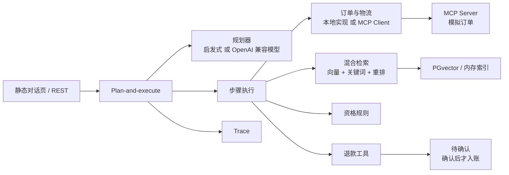

# aftersales-agent-spring-ai

电商售后客服 Agent 演示。用户问「我上周买的耳机能退吗」，助手按计划查订单、查签收、检索退换货条款，再给出带出处的资格结论。退款不会自动打款，必须等人确认。

作者：[Huang Qingxi](https://github.com/striveh)（GitHub `striveh`）。协议：MIT。

## English summary

A portfolio demo of an after-sales customer-service agent for a fictional shop, 澄光数码. Java 21, Spring Boot 3.5, Spring AI 1.1.8. The model is any OpenAI-compatible chat API (DeepSeek, Qwen via DashScope, or OpenAI), selected with environment variables. Postgres + pgvector is the vector store when you run the Docker profile.

The agent plans, then executes: look up the order, look up logistics, retrieve policy clauses, decide eligibility in Java, and answer with a citation to the document and section. Refunds open a pending approval; the ledger rejects a credit until a person confirms. Order and logistics lookups are an MCP server. The default process uses an in-memory index, an in-process tool, and a stub planner, so `mvn test` needs no API key and no database.

## 它展示什么

- **RAG。** 三份虚构的中文制度（退换货、保修、物流），按二级标题分块。检索是向量召回加关键词召回，RRF 融合后再重排。回答里的引用指向具体文档和条款，引用正文来自被采用的那一条，不是模型随手编的脚注。
- **工具。** 订单和物流查询是独立的 Spring AI MCP Server，数据是模拟的。Agent 在 Docker 配置里作为 MCP Client 调用它。退款是 Agent 进程内的 `@Tool`，而且被人工确认挡住。
- **多步规划。** Plan-and-execute。工具失败会重规划，最多两次；计划若原样重复就停止，避免死循环。每一步写入结构化 trace，日志名 `agent.trace`，也可以 `GET /api/traces/{conversationId}`。
- **评测。** 30 条中文用例。确定性检查覆盖工具调用、资格结论和引用是否存在。另有一个 LLM-as-judge 入口，只有配置了密钥才会跑。
- **对话页。** `http://localhost:8096` 显示回答、引用、计划步骤和退款确认。

资格结论由 Java 规则给出。模型（或离线启发式）只负责排步骤，以及在有密钥时润色措辞。金额始终是订单实付，不由模型填写。

## 架构



默认进程（`java -jar` 或 `mvn spring-boot:run`）走内存索引和进程内订单查询，没有密钥时用启发式规划。`docker compose up` 使用 `docker` profile：PGvector、MCP，以及你提供的模型密钥。没配密钥时，容器里的 Agent 仍用启发式规划，检索和工具走 Postgres 与 MCP。

## 模块

| 模块 | 作用 |
| --- | --- |
| `aftersales-common` | 模拟订单目录、订单和物流查询语义 |
| `aftersales-mcp-server` | Spring AI MCP Server，暴露 `lookup_order`、`lookup_logistics`，端口 8097 |
| `aftersales-agent` | 规划执行、检索、资格、退款确认、REST 和静态页，端口 8096 |
| `aftersales-eval` | 评测命令行。确定性检查始终运行；`--live` 才调用模型 |

制度原文在 `aftersales-agent/src/main/resources/policies/`。评测集在 `aftersales-agent/src/main/resources/eval/cases.json`。

## 快速开始

需要 JDK 21、Maven 3.9+。Docker 只在你要 Postgres 和 MCP 时需要。

一条命令拉起 Postgres、MCP Server 和 Agent：

```bash
docker compose up --build
```

浏览器打开 <http://localhost:8096>。健康检查：<http://localhost:8096/actuator/health>。Postgres 映射在宿主机 `55432`。

不启 Docker，只用内存索引和进程内工具：

```bash
mvn -pl aftersales-agent -am spring-boot:run
```

页面顶栏在没有密钥时显示「离线确定性规划」。选「林夏」，问「我上周买的耳机能退吗」。回答应指向订单 `ORD-DEMO-1001`，结论 `RETURN_NO_REASON`，引用「七天无理由退货」，并且没有退款确认卡。把问题改成「上周的耳机帮我退款」，才会出现确认按钮。确认之前账本不会入账，再点一次确认会告诉你已经处理过。

测试：

```bash
mvn -B verify
```

## 配置 DeepSeek、通义千问或 OpenAI

Spring AI 会在 base URL 后面拼接 `/v1/chat/completions`，所以 base URL **不要**自己带 `/v1`。

```bash
# DeepSeek
export OPENAI_BASE_URL=https://api.deepseek.com
export OPENAI_API_KEY=sk-...
export OPENAI_MODEL=deepseek-chat

# 通义千问 DashScope 兼容模式
# export OPENAI_BASE_URL=https://dashscope.aliyuncs.com/compatible-mode
# export OPENAI_MODEL=qwen-plus

# OpenAI
# export OPENAI_BASE_URL=https://api.openai.com
# export OPENAI_MODEL=gpt-4o-mini

docker compose up --build
```

`agent.llm.provider` 默认 `auto`：密钥为空或仍是占位符 `sk-placeholder` 时用启发式规划，否则用上面的兼容接口。强制离线可设 `AGENT_LLM_PROVIDER=stub`。

默认嵌入不是语义模型，而是 384 维的字符 bigram 哈希（`HashingEmbeddingModel`），这样没有嵌入 API 也能把文档放进 PGvector。换成真实嵌入时要同时改维度，并删掉旧的 `vector_store` 表。PGvector 使用 cosine 和 HNSW。

## 示例对话

下面是本机在 2026-10-19 对默认进程（内存索引、启发式规划、无 API key）的真实响应，时钟为系统日，演示订单按「今天」回溯。

```bash
curl -s http://localhost:8096/api/chat \
  -H 'content-type: application/json' \
  -d '{"message":"我上周买的耳机能退吗","customerPhone":"13800001001"}'
```

回答大意：林夏，订单 `ORD-DEMO-1001`（AirTune Pro 蓝牙耳机，实付 ¥299.00），签收日 2026-10-13，距今天 6 天，仍在七天无理由退货期内。依据《澄光数码退换货政策》「七天无理由退货」。助手明确说没有发起退款。

计划步骤：`lookup_order` → `lookup_logistics` → `retrieve_policy` → `decide_eligibility` → `draft_answer`。`decision` 为 `RETURN_NO_REASON`，`mode` 为 `stub`，响应里没有 `pendingApproval`。

同一客户说「上周的耳机帮我退款」时，结论仍是 `RETURN_NO_REASON`，并多一个状态为 `PENDING` 的确认单。回答末尾是「退款申请已生成，尚未打款，需要人工确认。金额 ¥299.00。」

```bash
curl -s http://localhost:8096/api/approvals/APR-替换成返回的id \
  -H 'content-type: application/json' \
  -d '{"approved":true}'
```

确认后的说明会写明这是演示账本，不会真实出账。

其他接口：`GET /api/demo/customers` 列出 19 位演示客户和示例问法；`GET /api/traces/{conversationId}` 返回该会话的计划、步骤和确认事件。

## 评测

确定性评测不调用模型。它检查每条用例的资格码、是否调用或禁止某个工具、引用条款、以及离线回答里的关键句。

| 检查 | 结果 | 如何复现 |
| --- | --- | --- |
| 确定性评测，30 条，启发式规划 | 30/30 通过，失败 0，模式 `stub` | 2026-10-19 在本仓库执行 `java -jar aftersales-eval/target/aftersales-eval-0.1.0-exec.jar` |
| `mvn -B verify` | 通过。common 6、MCP 3、agent 14（含上面那 30 条合成的 1 个测试） | 不需要 API key，不需要 Postgres |
| LLM-as-judge | 未运行 | 配置 `OPENAI_API_KEY` 后执行 `./scripts/eval.sh --live`。CI 在 `main` 上若没有该 secret 会跳过并成功退出 |

不要把上表当成模型质量分数。30/30 只说明离线规划器和规则、检索、确认流程与这 30 条预期一致。在线评测会把规划和润色交给真实模型，并把启发式兜底关掉；规划 JSON 解析失败就算失败。Judge 只重放每条用例的最后一句，多轮用例 E30 的 judge 看不到前一轮，这是已知限制。

用例覆盖：七天无理由（含第 7 天边界和第 8 天拒绝）、定制 / 食品 / 贴身衣物 / 已激活数字商品、未激活数字商品、未签收、丢件、24 小时内物流破损、超时破损但仍在七天内、十五天换货、保修、进水、缺件、已退款、多订单澄清、「上周」消歧、制度问答、闲聊、超范围、明确退款的人工确认，以及错误订单号后的重规划。

## 设计取舍

**为什么是 plan-and-execute，而不是让模型一边想一边调工具。** 售后问答的步骤大体固定，显式计划可以写进 trace，面试时能看见「查单失败后换了计划」。执行器是普通 Java：占位符 `$s1.orderId` 从上一步输出取值，失败才把错误交回规划器。同一计划重复出现就停止。资格、金额、能不能创建退款单都不由模型决定。

**为什么混合检索。** 制度条款短，用户又常用原词（「七天无理由」「物流破损」）。关键词通道保证这些原词能被找到；向量通道保留换一种说法时的召回。两路用 Reciprocal Rank Fusion（k = 60）合并，再按融合名次、bigram 覆盖和标题短语加分重排。`Reranker` 是替换点，当前实现不是 cross-encoder。官方 `pgvector/pgvector` 镜像没有 zhparser / pg_jieba，所以关键词不是分词 BM25：入库时把汉字拆成单字和双字，用 `to_tsvector('simple', ...)` 和 `ts_rank_cd`。内存模式下的关键词通道是同一套 bigram 重叠，这样没开 Postgres 时测试仍然有两路召回。

**为什么退款必须人工确认。** 问「能退吗」只解释资格。只有「帮我退款」「申请退款」这类明确意图，并且规则判定可退时，`requestRefund` 才创建 `PENDING` 单据。账本在状态变为 `APPROVED` 之前拒绝入账；对同一单再次确认是幂等的。这个工具不放进 MCP Server，因为确认状态属于这轮对话，而不是外部订单系统。

**为什么默认能离线跑。** CI 和 `mvn test` 不能依赖密钥。启发式规划器读取的是同一份规划提示里的标注，线上模型看到的约束和离线回退是一套。有密钥时换成 OpenAI 兼容 ChatModel，业务代码不变。

## 已知限制

- 嵌入是哈希，不是语义向量。换嵌入模型要改 384 维并重建表。
- 重排是词法打分，不是交叉编码器。
- 演示订单、物流和退款账本都在内存里，没有登录和权限。
- 本环境用 `docker compose config` 校验了 Compose 文件。容器栈本身没有在这里拉镜像跑通，首次 `docker compose up --build` 会构建两个 Java 镜像并拉取 `pgvector/pgvector:pg16`。
- 在线 judge 未在本仓库留下分数。跑完后终端会打印模型给的分数，那些数字不会写回 README。

## 许可

[MIT](LICENSE)。Copyright (c) 2026 Huang Qingxi.
